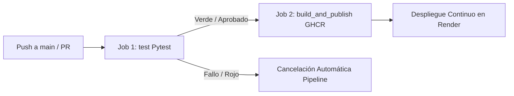

# DevOps Control Hub - Diplomado Sábados

Plataforma y taller práctico de ingeniería de software moderna enfocado en **Trunk-Based Development (TBD)**, **Feature Flags en vivo**, **Pruebas Automatizadas** y **Despliegue Continuo (CD)**.

---

## 🏛️ 1. Arquitectura del Frontend Estático sobre Nginx

El proyecto implementa un frontend moderno tipo dashboard desarrollado con:
* **HTML5 y JavaScript Puro (Vanilla JS):** Sin dependencias pesadas de frameworks ni pasos de compilación complejos de Node.js.
* **Tailwind CSS vía CDN:** Diseño responsivo, estética profesional y soporte nativo para modo oscuro (`darkMode: 'class'`).
* **Nginx Alpine (Docker):** El artefacto final es un contenedor ultra-ligero basado en `nginx:alpine` que sirve los archivos estáticos en el puerto `80`, garantizando alta disponibilidad, bajo consumo de recursos y portabilidad total.

---

## 🚩 2. El Rol de ConfigCat (Feature Flagging)

Para aplicar las disciplinas de Trunk-Based Development sin riesgo de romper producción:
* **Desacople de Deploy y Release:** El código se despliega continuamente a producción en la rama `main`, pero las funcionalidades experimentales o en desarrollo se mantienen ocultas mediante toggles (*Dark Launching*).
* **Evaluación en Tiempo Real:** El SDK de ConfigCat se importa vía CDN en el cliente y consulta el flag booleano `dark_mode_enabled`.
  * **Si es `true`:** El botón de cambio de tema se muestra en la barra de navegación superior (Navbar), permitiendo alternar entre modo claro y oscuro con transiciones fluidas.
  * **Si es `false`:** El botón se oculta por completo del DOM sin afectar la experiencia del usuario.
* **Sincronización Reactiva:** Incluye sondeo en segundo plano (*AutoPoll*) para reflejar los cambios realizados en el dashboard de ConfigCat sin requerir recargas ni nuevos despliegues.

---

## 🚀 3. Flujo del Pipeline CI/CD (GitHub Actions)

El archivo de automatización [`.github/workflows/ci.yaml`](.github/workflows/ci.yaml) implementa una compuerta de calidad secuencial (*Quality Gate*):



1. **Job 1 (`test`):**
   * Configura Python 3.11 e instala las dependencias de prueba (`pytest`, `beautifulsoup4`).
   * Ejecuta la suite automatizada [`src/test_interface.py`](src/test_interface.py), validando la integridad del HTML, la presencia de CDNs y los selectores requeridos.
2. **Job 2 (`build_and_publish`):**
   * Se ejecuta únicamente si el job `test` finalizó con éxito (`needs: test`).
   * Construye la imagen Docker basada en `nginx:alpine`.
   * Publica la imagen en **GitHub Container Registry (`ghcr.io`)** etiquetada como `:latest`.
3. **Despliegue Continuo:**
   * **Render** detecta la actualización de la rama `main` y actualiza automáticamente el servicio en vivo.

---

## 🧪 4. Ejecución y Pruebas Locales

### Ejecutar las Pruebas con Pytest
```bash
# Instalar dependencias de pruebas
pip install -r requirements.txt

# Correr la suite de pruebas
pytest -v
```

### Ejecutar con Docker Localmente
```bash
# Construir la imagen local
docker build -t devops-dashboard .

# Ejecutar el contenedor en el puerto 8080
docker run -d -p 8080:80 --name mi-dashboard devops-dashboard

# Abrir en el navegador: http://localhost:8080
```

---

## 📖 5. Documentación y Acuerdos de Equipo

* [📘 **Scrum + TBD Playbook**](SCRUM_TBD_PLAYBOOK.md): Guía viva con la definición de ceremonias, políticas de ramas cortas y la **Definition of Done (DoD) definitiva**.
