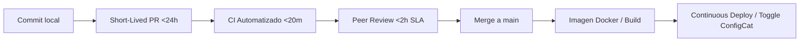
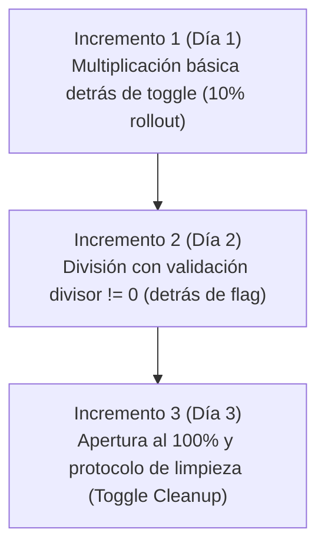
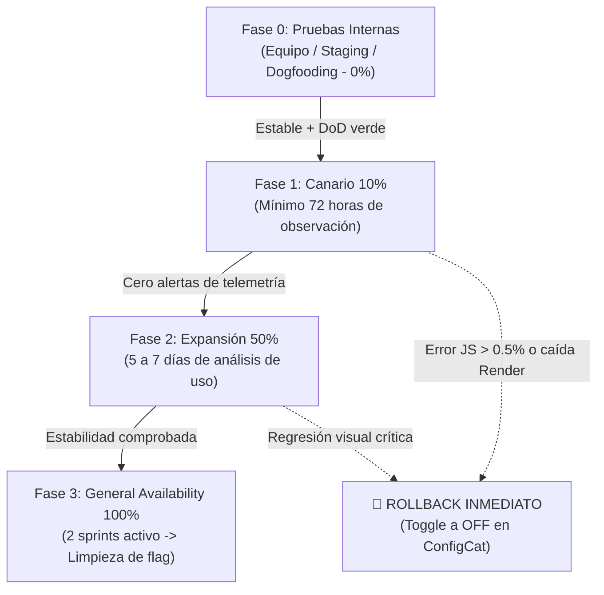
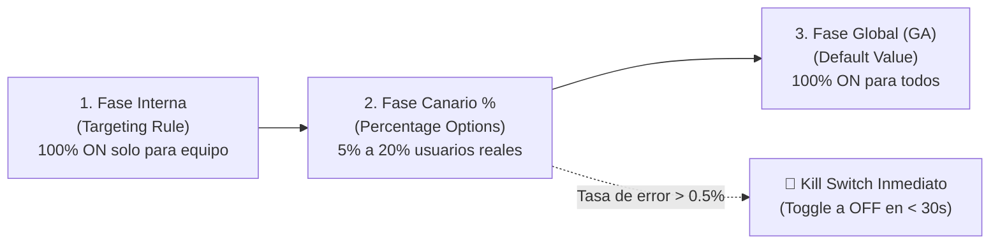

# 📘 Scrum + TBD Playbook
> **Adaptación de Scrum a entornos de Despliegue Continuo y Trunk-Based Development (TBD)**  
> *Artefacto vivo y operativo de trabajo en equipo — Consolidado con acuerdos del Taller 4*

---

## 🎯 1. Propósito y Contexto
Este Playbook establece los acuerdos de trabajo, responsabilidades, adaptación de ceremonias y criterios de calidad para que el equipo opere bajo el marco **Scrum** alineado con **Trunk-Based Development (TBD)** y **Despliegue Continuo (CD)**.

* **Objetivo:** Garantizar que la rama `main` esté **siempre verde, estable y potencialmente desplegable (releasable)** en cualquier momento, reduciendo los tiempos de ciclo, maximizando el flujo de valor y eliminando por completo el miedo al despliegue.

---

## 🚦 2. Diagnóstico del Flujo Actual (Mapa de Fricciones)
*Dinámica de diagnóstico continuo para identificar cuellos de botella y optimizar el rendimiento del pipeline.*



### Semáforo de Salud del Flujo
| Estado | Elemento del Flujo | Observaciones / Aprendizajes |
| :--- | :--- | :--- |
| 🟢 **Funciona Bien** | Commits locales frecuentes, tests automáticos y Docker build | Commits frecuentes locales, tests unitarios automáticos y build de imagen Docker en CI. |
| 🟡 **Genera Fricción** | Ramas de mediana/larga duración | Ramas abiertas por más de 24 horas que acumulan conflictos y riesgo de integración. |
| 🔴 **Rompe Flujo / Miedo** | Cuello de botella en autorizaciones de merge | Dependencia de aprobaciones burocráticas o revisiones tardías que frenan el despliegue diario. |

> **Preguntas Clave del Equipo:**
> 1. *¿Cuánto tiempo vive normalmente una rama de desarrollo en nuestro repo?* (Meta TBD: `< 24 horas`).
> 2. *¿Qué tan seguido integramos realmente a `main`?* (Meta: al menos 1 vez al día por desarrollador).
> 3. *¿Nuestro Definition of Done (DoD) y Definition of Ready (DoR) garantizan que `main` sea desplegable a producción de forma segura?*

---

## 🧭 3. Los 5 Principios de Oro (Scrum + TBD)
1. **`main` es Sagrado y Siempre Releasable:** Ningún cambio que rompa pruebas o la compilación permanece en `main`. Si `main` se rompe, arreglarlo es la prioridad #1 de todo el equipo.
2. **Small Batches (Lotes Pequeños):** Dividir el trabajo en rebanadas verticales (*slicing*) tan pequeñas que puedan integrarse en cuestión de horas (< 24h), no días.
3. **Desacoplar Despliegue de Liberación (*Deploy vs Release*):** Usar **Feature Toggles / Flags** (ConfigCat) para desplegar código incompleto a producción de forma segura sin exponerlo a los usuarios finales.
4. **Calidad Integrada en el Pipeline (CI como Árbitro):** Las pruebas automatizadas, linters y análisis de seguridad son los guardianes de la calidad antes y después del merge.
5. **Responsabilidad Colectiva:** Todo el equipo es dueño de la estabilidad de producción, de la fluidez del pipeline y del rápido desbloqueo de PRs.

---

## 👥 4. Roles Adaptados a TBD + Continuous Deployment

```
┌────────────────────────────────────────────────────────────────────────┐
│                        RESPONSABILIDADES DE ROL                        │
├─────────────────┬────────────────────────────┬─────────────────────────┤
│  Product Owner  │         Developers         │      Scrum Master       │
│                 │                            │                         │
│ • Prioriza por  │ • Mantienen main verde     │ • Facilita disciplina   │
│   valor y batch │ • Lotes pequeños (<24h)    │   de integración diaria │
│ • Define flags  │ • Ownership del pipeline CI│ • Elimina el miedo a    │
│ • Slicea con el │ • Monitorean producción    │   romper main           │
│   equipo        │ • Fast Code Reviews (<2h)  │ • Registra Lead Time PR │
└─────────────────┴────────────────────────────┴─────────────────────────┘
```

### Compromisos Individuales (*Acuerdos del Taller*)
* **Product Owner:**
  * [x] Dividiré historias en bloques de 1 día y usaré Feature Toggles en ConfigCat para desacoplar despliegues de lanzamientos comerciales.
* **Developers:**
  * [x] No dejaré ramas abiertas más de 24 horas y revisaré las Pull Requests de mis compañeros en menos de 2 horas para evitar cuellos de botella.
  * [x] Realizaré commits atómicos con pruebas locales y asumiré la responsabilidad inmediata de reparar el pipeline de CI si un merge genera fallos.
* **Scrum Master:**
  * [x] Centraré las Daily Scrums en destrabar integraciones a main, registraré el Lead Time de PRs (<24h) y eliminaré bloqueos en permisos de GitHub.

---

## 🔄 5. Artefactos y Ceremonias: Clásico vs. TBD + CD

| Artefacto / Ceremonia | Versión Clásica | Adaptación TBD + CD | Guía de Acción en el Equipo |
| :--- | :--- | :--- | :--- |
| **Product Backlog** | Lista de historias grandes por funcionalidad completa. | Historias sliceadas + plan de **Feature Toggles** + Criterios de Aceptación verificables en producción. | Escribir historias pensadas en activación progresiva (*Dark launching / Toggles*). |
| **Sprint Backlog** | Compromiso de paquetes cerrados de trabajo al final del sprint. | Flujo de trabajo continuo ordenado por valor y riesgo que se integra a `main` diariamente. | Medir rendimiento por *Cycle Time* y estabilidad de ramas en lugar de estimaciones rígidas. |
| **Incremento** | Paquete de software entregable solo al final del Sprint. | **Cada commit en `main` que pasa CI es un Incremento potencial listo para producción.** | El valor se entrega continuamente a lo largo del Sprint. |
| **Sprint Planning** | Planificación enfocada en estimar puntos de historia. | Planificación enfocada en **estrategia de Slicing, capacidad realista y arquitectura de flags**. | Definir el Sprint Goal desacoplado y el plan de integración diaria (Día 1 a N). |
| **Daily Scrum** | "¿Qué hice ayer? ¿Qué haré hoy? ¿Qué impedimentos tengo?" | **"¿Qué voy a integrar hoy a `main` y qué necesito del equipo para que sea seguro y rápido?"** | Foco total en destrabar PRs, code reviews y mantener `main` verde. |
| **Sprint Review** | Demo tradicional en ambiente local o staging del trabajo acumulado. | **Demo de lo que ya está en producción activando/desactivando flags en vivo con ConfigCat.** | Demostrar funcionalidades en vivo con datos reales y telemetría de producción. |
| **Sprint Retrospective** | Enfoque exclusivo en dinámicas de equipo y comunicación. | **Mejora del flujo de valor + salud del pipeline + disciplina TBD + métricas DORA.** | Analizar fallos de CI, tiempo de vida de PRs y tiempos de code review. |

---

## 📋 6. Definition of Ready (DoR) Orientada a TBD
Para que una historia o incremento pueda ingresar al **Sprint Backlog** durante el Refinamiento o Sprint Planning, debe cumplir obligatoriamente con los siguientes **5 criterios mínimos de salud TBD**:

- [ ] **1. Slice ≤ 1 día:** La historia está dividida verticalmente de modo que pueda implementarse, integrarse a `main` y pasar CI en menos de 24 horas de trabajo.
- [ ] **2. Acceptance Criteria verificables en producción:** Criterios de aceptación testeables una vez desplegado el código en vivo (no limitados únicamente a pruebas en entornos locales o aislados).
- [ ] **3. Feature Toggle definido:** Se estableció explícitamente si requiere flag, la clave técnica en ConfigCat (ej. `isFeatureNameEnabled`) y el porcentaje inicial de rollout (ej. `10%` pruebas internas).
- [ ] **4. Cero dependencias bloqueantes externas:** La tarea no depende de ramas abiertas de otros desarrolladores ni de componentes incompletos en progreso.
- [ ] **5. Estrategia de validación acordada:** El equipo y el Product Owner tienen definido claramente cómo y con qué datos se verificará la funcionalidad en vivo una vez desplegada.

---

## ✅ 7. Definition of Done (DoD) Definitiva (TBD + CD)
Para que una historia, tarea o incremento se considere **Done** y listo para producción, debe cumplir obligatoriamente con los siguientes tres pilares fundamentales:

### 🎯 Pilares del DoD Definitivo
1. **Tests automatizados en Pytest pasando en verde en GitHub Actions:** Todo cambio debe superar la suite de integridad (`src/test_interface.py`) en el job secuencial `test` antes de autorizar la construcción de la imagen Docker.
2. **Despliegue continuo hacia Render activo desde la rama main:** Una vez superado el pipeline y publicada la imagen en GitHub Container Registry (`ghcr.io`), el servicio web en **Render** debe desplegar de manera continua y automática el nuevo contenedor.
3. **Funcionalidades experimentales protegidas con Feature Flags en ConfigCat:** Cualquier capacidad nueva, en validación o experimental debe estar gobernada por un flag técnico en **ConfigCat** (desacoplando el *Deploy* técnico del *Release* comercial mediante *Dark Launching*).

### ⚙️ Criterios Técnicos de Verificación
- [ ] Código desarrollado en una rama de vida corta (< 24h) integrado a `main`.
- [ ] **Tests automatizados en Pytest pasando en verde en GitHub Actions (`pytest -v`).**
- [ ] Pipeline de CI/CD completado sin errores (bloqueo automático ante fallos de test).
- [ ] **Despliegue continuo hacia Render activo desde la rama main.**
- [ ] **Funcionalidades experimentales protegidas con Feature Flags en ConfigCat.**
- [ ] Code Review aprobado por al menos 1 par (< 2h SLA).

### 💼 Criterios de Negocio y Operación
- [ ] Criterios de Aceptación verificados en vivo en producción (Render) usando toggles.
- [ ] Feature Flag probado en encendido/apagado en tiempo real sin redeploy.
- [ ] Métricas de observabilidad y dashboard operativo.
- [ ] Documentación técnica (`README.md`, Playbook) sincronizada.

---

## 📅 8. Planificación de Sprint Orientada a Flujo

### 🎯 Formato de Sprint Goal Orientado a TBD
El Sprint Goal debe reflejar la entrega continua de valor desacoplando el despliegue del lanzamiento comercial:

> **Plantilla:**  
> *"Al final del sprint los usuarios podrán **[Capacidad X]**, aunque **[Funcionalidad Y]** todavía esté protegida detrás de toggle en ConfigCat."*

* **Ejemplo Real del Equipo:**
  > *"Al final del sprint los usuarios podrán **ejecutar operaciones de resta en la calculadora de forma estable**, mientras que **las operaciones avanzadas (multiplicación/división) estarán integradas en producción al 10% detrás de ConfigCat** para validación interna."*

---

### 📊 Reglas de Orden del Sprint Backlog
1. **Criterios de Ordenación:** Los ítems del backlog se ordenan balanceando:
   $$\text{Prioridad} = \text{Valor de Negocio} + \text{Riesgo de Integración} + \text{Dependencia Técnica}$$
2. **Regla de Oro:** **El primer ítem del Sprint Backlog debe poder integrarse a `main` el Día 1 o Día 2 del sprint.** Queda prohibido postergar todas las integraciones hacia el final del ciclo.

---

### 🗺️ Matriz de Plan de Integración Diaria
| Ventana Temporal | Foco del Incremento | Objetivo de Integración en `main` | Estado en ConfigCat |
| :--- | :--- | :--- | :--- |
| **Día 1 - 2** | *Resta UI & Backend + Base Multiplicación* | Primer merge a `main` con tests en verde. Estructura de flag inicial. | `isSubtractionEnabled` al 100%<br>`isAdvancedOpsEnabled` al 10% (interno) |
| **Día 3 - 4** | *División con validaciones de seguridad* | Segundo merge a `main` con manejo de excepciones (divisor $\neq 0$). | `isAdvancedOpsEnabled` al 10% - 50% |
| **Día 5+** | *Estabilización, Rollout 100% y Cleanup* | Liberación general a usuarios y eliminación de deuda técnica/toggles obsoletos. | `isAdvancedOpsEnabled` al 100% $\rightarrow$ Flag deprecado / Limpieza |

---

### ⏳ Ajuste de Capacidad Realista (Buffer & Overhead TBD)
Para evitar la sobrecarga y asegurar que el código fluya sin fricción hacia producción, se descuenta de la capacidad bruta:
* **2 horas diarias por desarrollador:** Dedicadas exclusivamente a **Fast Code Reviews (< 2h SLA)** y desbloqueo de PRs de pares.
* **20 minutos por commit/PR:** Para la ejecución y monitoreo del **Pipeline de CI** (linters, pruebas unitarias y Docker build).
* **Colchón para la Regla de los 10 Minutos:** Reserva de tiempo para atención prioritaria inmediata si `main` llega a romperse.

---

## 🛠️ 9. Técnicas de Sliceado Vertical (Template y Caso Real)

### 📋 Plantilla Oficial de Slicing (Taller 4)
Toda historia compleja debe descomponerse utilizando la siguiente estructura estándar:

```markdown
* **Título formal:** [tipo]: [descripción concisa de la rebanada vertical]
* **Descripción:** [Qué capacidad conecta de punta a punta: UI + Backend + CI]
* **Corte Vertical (Slice para TBD):** [Alcance exacto integrable a main en < 24h]
* **Estrategia de Feature Toggle:** [Nombre del flag en ConfigCat + % rollout inicial]
* **Criterios de Aceptación (AC) en Producción:**
  1. [Comportamiento verificable 1 en UI/API]
  2. [Comportamiento condicional con ConfigCat (ON/OFF)]
  3. [Rollout y público objetivo inicial]
  4. [Pipeline CI en verde: tests, linters y Docker build aprobados]
```

---

### 🔬 Caso Real: Re-sliceado de Operaciones Avanzadas en 3 Incrementos Diarios
Descomposición vertical de la historia riesgosa de *Operaciones Avanzadas (Multiplicación y División)* en micro-incrementos diarios:



#### 🔹 Incremento 1 (Día 1): Multiplicación Básica detrás de Toggle
* **Título formal:** `feat: conectar multiplicacion() en frontend bajo feature toggle`
* **Descripción:** Conectar interfaz de usuario y backend para realizar multiplicaciones aritméticas básicas.
* **Corte Vertical (Slice para TBD):** Implementación completa de multiplicación (UI + Lógica + Test) integrada a `main` en <24h, oculta para usuarios generales.
* **Estrategia de Feature Toggle:** Flag `isAdvancedOpsEnabled` en ConfigCat con **rollout inicial al 10%** (usuarios de prueba interna).
* **Criterios de Aceptación en Producción:**
  1. La operación `multiplicar(a, b)` ejecuta correctamente y muestra resultado en UI para usuarios habilitados.
  2. Para el 90% restante de usuarios, la opción no es visible ni interactiva.
  3. Tests unitarios en verde cubriendo casos base. CI 100% aprobado en `main`.

#### 🔹 Incremento 2 (Día 2): División con Validación de Seguridad
* **Título formal:** `feat: conectar division() con validacion de divisor cero bajo toggle`
* **Descripción:** Incorporar la operación de división asegurando validación de divisor diferente de cero (`b != 0`).
* **Corte Vertical (Slice para TBD):** Integración de lógica de división, manejo de error/alerta en UI y pruebas de división por cero en <24h.
* **Estrategia de Feature Toggle:** Reutiliza `isAdvancedOpsEnabled` en ConfigCat, manteniendo el rollout en **10% - 25%**.
* **Criterios de Aceptación en Producción:**
  1. La operación `dividir(a, b)` calcula correctamente cuando $b \neq 0$.
  2. Mensaje de error claro en UI si $b = 0$, sin romper el estado de la aplicación.
  3. Cobertura de pruebas unitarias para divisiones válidas e inválidas en CI.

#### 🔹 Incremento 3 (Día 3): Apertura al 100% y Protocolo de Limpieza (*Toggle Cleanup*)
* **Título formal:** `feat: liberar operaciones avanzadas al 100% y remover feature toggle`
* **Descripción:** Habilitación general de multiplicación y división para todos los usuarios y remoción del código condicional.
* **Corte Vertical (Slice para TBD):** Incremento de rollout al 100% en ConfigCat, validación de métricas de error y PR de limpieza de deuda técnica eliminando el flag.
* **Estrategia de Feature Toggle:** `isAdvancedOpsEnabled` al **100%**, seguido de eliminación del flag en código y en ConfigCat.
* **Criterios de Aceptación en Producción:**
  1. El 100% del tráfico accede a multiplicación y división de forma fluida.
  2. Cero incremento en tasas de error en producción.
  3. Código refactorizado: `if (flag)` eliminado, código limpio y tests actualizados. Flag archivado en ConfigCat.

---

## 📌 10. Acuerdos Técnicos y Decisiones para el Próximo Sprint

| Tema / Compromiso | Estado / Decisión Definitiva | Responsable | Meta / SLA |
| :--- | :--- | :--- | :--- |
| **Filtro DoR en Refinamiento** | **Ninguna historia ingresa a Planning sin pasar los 5 criterios de salud TBD** (Tamaño ≤ 1 día, Verticalidad, Toggle definido, Cero bloqueos y Validación acordada). | Product Owner / Developers | 100% de historias listas |
| **Medición de Flujo (Lead Time)** | **El Scrum Master registrará el Lead Time de las PRs** (desde apertura de PR hasta merge a `main`), detectando demoras en revisiones. | Scrum Master | **Merge a `main` < 24h** |
| **Branch Protection** | Modificación en GitHub Rulesets: eliminar aprobación exclusiva del Admin y reemplazarla por **Peer Review obligatorio (1 Developer)** + **CI en verde obligatorio** antes del merge a `main`. | Tech Lead / DevOps | Inmediato / Activo |
| **SLA de Code Reviews** | Compromiso de revisión y feedback de Pull Requests en un tiempo máximo estipulado. | Developers | **< 2 horas SLA** |
| **Gestor de Feature Flags** | **Adopción definitiva de ConfigCat** con convención estándar (`isFeatureNameEnabled`) y protocolo de limpieza post-release. | Developers / Tech Lead | En uso constante |
| **Pipeline CI (GitHub Actions)** | Automatización obligatoria de linters, pruebas unitarias (`pytest`) y build de imagen Docker en cada PR y push a `main`. | DevOps / Developers | Pipeline < 20 min |

---

## 🚀 11. Regla de Emergencia: `main` Roto
Si un commit en `main` rompe el pipeline de CI:
1. **Detener nuevos merges:** Nadie integra a `main` hasta que el pipeline esté completamente verde.
2. **Regla de los 10 minutos:** Si el fix no se identifica y corrige en 10 minutos, se ejecuta **`git revert`** del commit causante de forma inmediata.
3. **Investigar en local:** El desarrollador replica e investiga el problema en su entorno local con pruebas unitarias antes de volver a someter una PR.

---

## 12. Adaptación a Continuous Deployment y Liberación Segura (Taller 6)
> **Consolidación de acuerdos de equipo, tableros de Miro y ceremonias orientadas a Despliegue Continuo (CD), Feature Flagging y Observabilidad.**

---

### 🎭 12.1 Nuevo Formato del Sprint Review (Enfoque en Producción y Feature Flags)

Tradicionalmente, la Sprint Review se limitaba a mostrar funcionalidades en entornos locales o de pruebas (*staging*). Bajo nuestro modelo de **Continuous Deployment + Trunk-Based Development**, el formato evoluciona hacia una demostración de valor real en vivo:

1. **Desacople Total de Demo y Despliegue:**
   * Las demostraciones se ejecutan **exclusivamente en el entorno de producción en vivo ([Render](https://render.com))**.
   * Se elimina la frase *"en mi máquina funciona"*: el código ya fue integrado a `main`, compilado en Docker y desplegado a producción antes de iniciar la ceremonia.

2. **Protocolo Oficial de Demo con Feature Flags:**
   * **Paso 1 (Estado Oculto / Dark Launch):** Se proyecta la aplicación en vivo con el toggle `dark_mode_enabled` en **OFF**. Los asistentes comprueban que el botón `#theme-toggle` está totalmente ausente del DOM visual (clase `hidden`), garantizando cero impacto para usuarios no autorizados.
   * **Paso 2 (Activación en Tiempo Real):** El Product Owner o Tech Lead ingresa al dashboard en vivo de **ConfigCat** y activa el flag para el segmento de prueba o en porcentaje de muestra.
   * **Paso 3 (Evaluación Reactiva en Vivo):** Sin recargar la página ni ejecutar un nuevo despliegue, el cliente web detecta el cambio vía *AutoPoll*, renderiza el botón de modo oscuro y permite alternar temas fluidamente, evidenciando el desacople de *Deploy vs Release*.

3. **Foco en Valor y Observabilidad (No solo "Código Terminado"):**
   * La revisión no evalúa únicamente que la UI responda, sino la **observabilidad asociada**: se inspecciona la consola del navegador y los paneles de telemetría para validar los eventos emitidos (`FlagEvaluated`, `ThemeToggled`), verificando que no existan errores de cliente o degradación visual.

---

### 🔄 12.2 Inspección de Flujo y Pipeline en la Sprint Retrospective

La Retrospectiva incorpora el análisis cuantitativo de la infraestructura de entrega continua y la disciplina de ingeniería:

#### 📊 Métricas Obligatorias de CI/CD e Infraestructura
* **Tasa de Fallos en GitHub Actions:** Porcentaje de builds en rojo en la rama `main`. Meta acordada: **< 5%** de ejecuciones fallidas al mes.
* **Tiempo Promedio de Ciclo (Build & Deploy):** Tiempo transcurrido desde el push a `main` hasta que la imagen Docker se publica en `ghcr.io` y Render completa el despliegue. Meta acordada: **< 5 minutos**.
* **Health Check en Render:** Verificación de disponibilidad del servicio estático sirviendo en el puerto 80 sobre Nginx Alpine, con uptime objetivo del **99.9%**.

#### ⚡ Disciplina Trunk-Based Development (TBD)
* **Política de Ramas Efímeras:** Ninguna rama de trabajo vive más de **24 horas**. Si una funcionalidad es compleja, se corta en rebanadas verticales (*vertical slicing*) y se oculta detrás de un flag de ConfigCat.
* **Prohibición de ramas `develop`:** Todo commit se integra directamente a `main` mediante Pull Requests pequeñas revisadas en un SLA máximo de 2 horas.

#### 🧹 Gestión de Deuda Técnica y Caducidad de Flags (*Flag Lifecycle Policy*)
* **Regla de Expiración:** Cualquier Feature Flag que alcance el **100% de rollout y permanezca estable durante 2 sprints consecutivos** es considerado *deuda técnica obligatoria*.
* **Acción de Limpieza:** En el sprint inmediatamente posterior, se debe planificar y ejecutar la tarea de refactorización para remover el condicional `if (flag)` del código fuente, limpiar las referencias en pruebas unitarias y archivar el flag en ConfigCat.

#### 🎯 Las 3 Acciones de Mejora del Sprint (Compromisos Vivos)
1. **Monitoreo y Telemetría Client-Side:** Implementar y estandarizar `window.telemetry` con listeners globales (`error` y `unhandledrejection`) y captura de excepciones en eventos de UI.
2. **Limpieza Sistemática de Flags Caducos:** Automatizar la creación de tickets de limpieza de código en cuanto un flag complete su ciclo de liberación en producción.
3. **Ajuste del DoD con Pre-Commit de Pytest:** Ejecutar obligatoriamente en local la suite de pruebas unitarias (`pytest -v`) antes de empujar ramas remotas para evitar fallos prevenibles en GitHub Actions.

---

### 🛡️ 12.3 Protocolo Oficial de Rollout Seguro (*Safe Release Matrix*)

Para mitigar riesgos al liberar funcionalidades a producción, el equipo adopta una matriz progresiva de 4 fases de activación:



#### Matriz de Fases de Liberación

| Fase | Alcance de Tráfico | Ventana de Observación | Criterio de Éxito para Avanzar |
| :--- | :--- | :--- | :--- |
| **Fase 0: Interna** | Solo equipo de desarrollo y QA | 24 - 48 horas | Tests de Pytest en verde, validación de telemetría y aprobación de PO. |
| **Fase 1: Canario** | **10%** de usuarios reales | **Mínimo 72 horas continuas** | Tasa de error JS inferior al 0.1%, eventos `FlagEvaluated` reportados correctamente. |
| **Fase 2: Expansión** | **50%** de usuarios reales | **5 a 7 días** | Métricas de rendimiento estables, sin incremento de soporte ni reportes de UI. |
| **Fase 3: GA (100%)** | **100%** de la base de usuarios | **2 sprints completos** | Comportamiento óptimo continuo. Finalizada la fase, se programa el retiro del flag. |

#### 🚨 Criterios Estrictos de Rollback Inmediato (*Circuit Breakers*)
Si durante cualquiera de las fases se detecta alguno de los siguientes eventos en producción, se procede al **apagado instantáneo del toggle en ConfigCat (Kill Switch)** en menos de 30 segundos, sin necesidad de revertir código en Git ni generar un nuevo despliegue:

* **Tasa de errores de JavaScript > 0.5%** capturada por `window.telemetry.logError` o consola del cliente.
* **Fallo del Health Check en Render:** Dos fallos consecutivos de respuesta HTTP 5xx o timeout en el contenedor web.
* **Regresiones Visuales Críticas:** Inconsistencias de estilos que impidan la interacción con elementos esenciales de navegación o toggles.

---

### ✅ 12.4 Definition of Done (DoD) Definitiva y Actualizada

Una historia de usuario o incremento técnico solo se considera **Terminado (Done)** si satisface íntegramente la siguiente lista de verificación:

* [ ] **Código y Arquitectura:** Implementado en Vanilla JS / HTML5 semántico con estilos Tailwind CSS, desacoplado de dependencias innecesarias.
* [ ] **Feature Flag Integrado:** Toda nueva funcionalidad o cambio de comportamiento está protegido bajo un flag de **ConfigCat** (`dark_mode_enabled` o convención `isFeatureNameEnabled`).
* [ ] **Estado Inicial Seguro:** Los elementos visuales condicionales inician ocultos por defecto (`class="hidden"`) y cuentan con atributos identificadores como `data-testid="theme-toggle"`.
* [ ] **Observabilidad y Telemetría:** El código incluye instrumentación cliente mediante `window.telemetry`:
  * Emisión de eventos de éxito (`logEvent`) como `FlagEvaluated` y `ThemeToggled`.
  * Captura de fallos (`logError`) dentro de bloques `try/catch` en la inicialización del SDK y en los listeners de UI.
  * Presencia del capturador global de errores (`window.addEventListener('error', ...)`).
* [ ] **Pruebas Automatizadas en Pytest:** Suite [`src/test_interface.py`](src/test_interface.py) ejecutada localmente y pasando al **100% en verde** (validando HTML, CDNs, selectores clave, comportamiento de toggles y telemetría).
* [ ] **Pipeline CI/CD Aprobado:** Pull Request aprobada con los jobs de `test` y `build_and_publish` finalizados con éxito en GitHub Actions.
* [ ] **Despliegue Continuo Verificado:** Servicio desplegado automáticamente y respondiendo en el contenedor de Render.
* [ ] **Plan de Rollout Documentado:** La historia cuenta con su matriz de liberación (Fases 0 a 3) y criterios de rollback definidos en el ticket antes de iniciar el rollout.

---

### 🎛️ 12.5 Estrategia de Liberación en 3 Fases en ConfigCat (Targeting y Porcentaje)

Para responder a la pregunta central del Taller 6: *"¿A quién se la activamos primero? (interno → % de usuarios → todos)"*, el equipo formaliza la **estrategia de liberación segura dividida en 3 partes/fases**:



#### 🛠️ Guía Paso a Paso de Configuración en el Dashboard de ConfigCat

| Fase / Parte | Tipo de Regla en ConfigCat | Configuración Exacta en el Dashboard | Audiencia y Comportamiento |
| :--- | :--- | :--- | :--- |
| **Parte 1: Interno** | **Targeting Rule** | 1. Clic en *"Add Targeting Rule"*.<br>2. Atributo: `Email` o `Identifier`.<br>3. Comparador: `CONTAINS` o `IS ONE OF`.<br>4. Valor: `dev@equipo.com` o `internal`.<br>5. Servir: **ON (True)**. | Solo desarrolladores y testers internos ven la funcionalidad activa en producción. El resto ve OFF. |
| **Parte 2: Porcentaje** | **Percentage Options** | 1. En la regla por defecto o secundaria, activar *"Percentage Options"*.<br>2. Primer escalón: **5% ON / 95% OFF**.<br>3. Segundo escalón (tras 48h estables): **20% ON / 80% OFF**.<br>4. Guardar y publicar (*Save & Publish*). | ConfigCat aplica un algoritmo hash determinista sobre el `identifier` del usuario para asignarlo consistentemente al cubo de porcentaje. |
| **Parte 3: Todos (GA)** | **Default Value (100%)** | 1. Cambiar el valor por defecto a **ON (True)** para el 100% del tráfico.<br>2. Se deshabilitan las reglas intermedias de porcentaje.<br>3. Se agenda el ticket de limpieza de deuda técnica (*Toggle Cleanup*). | Lanzamiento comercial total (General Availability) respaldado por telemetría limpia y sin errores. |

> [!IMPORTANT]
> **Requisito Técnico Mandatorio del SDK:**  
> Para que ConfigCat pueda evaluar las **Targeting Rules** y la **distribución porcentual (Percentage Options)**, el código del cliente debe pasar obligatoriamente el objeto de usuario:
> ```javascript
> const userObject = {
>   identifier: "usuario_unico_123", // Requerido para el cálculo del hash del %
>   email: "dev@equipo.com",          // Usado para reglas de targeting
>   custom: { role: "internal" }
> };
> const isEnabled = await client.getValueAsync("dark_mode_enabled", false, userObject);
> ```
> *Si no se envía el `userObject`, ConfigCat ignora el porcentaje y recurre al valor por defecto.*

---

### 💼 12.6 Resolución Oficial del Caso de Estudio: "Pagos Express con un solo clic"

#### 📌 Contexto y Dilema del Caso
* **Situación:** La funcionalidad *"Pagos Express"* lleva 9 días en `main`, protegida por el toggle `pagos-express-v1` en **OFF**. Cumple el DoD técnico y pasó CI.
* **Presión comercial:** El Product Owner y Negocio quieren activar el toggle al **20% este viernes** porque la campaña de marketing ya fue lanzada.
* **Riesgos y deuda técnica detectados:**
  1. Caída reciente del health check en Render durante 11 minutos (rollback manual).
  2. 3 toggles viejos (> 45 días) sin limpiar acumulando deuda técnica.
  3. Sprint con solo 4 integraciones a `main` (pérdida de cadencia TBD).
  4. Rama viva 4 días por un test flaky en CI.
  5. Cero métricas de observabilidad en errores o conversión de pagos.

#### ⚖️ Acuerdos Maduros del Equipo (Solución Oficial)

1. **Sprint Review Adaptado (Transparencia con Negocio):**
   * Se realiza la demo con el toggle en **OFF** primero (reflejando el estado real en producción).
   * Se activa temporalmente en vivo **únicamente para un usuario de prueba interno** para mostrar el flujo.
   * El PO comunica con transparencia técnica y de negocio:  
     > *"La funcionalidad está técnicamente integrada y desplegada, pero aún no se libera a usuarios reales porque debemos garantizar métricas de observabilidad y estabilidad del pipeline. La campaña de marketing se pausará o reprogramará."*
   * **Se prohíbe comprometer fechas de activación comercial no respaldadas por estabilidad técnica.**

2. **Sprint Retrospective (Compromisos Concretos del Equipo):**
   * **Acción 1 (SLA 24h):** Reparar y estabilizar el test flaky de inmediato (prioridad P0 para desbloquear TBD).
   * **Acción 2 (SLA 3 días):** Implementar el dashboard mínimo de métricas de telemetría (tasa de errores y conversión).
   * **Acción 3 (Este Sprint):** Ejecutar PRs de limpieza (*Toggle Cleanup*) retirando los 3 flags obsoletos de más de 45 días.
   * **Acuerdo de Seguridad:** No se activará ningún toggle nuevo a usuarios reales hasta que el pipeline registre **al menos 7 despliegues consecutivos sin fallos de health check**.

3. **Estrategia de Liberación Segura Aprobada:**
   * **Viernes:** NO se activa al 20%.
   * **Paso 1:** Resolver test flaky + limpiar toggles viejos + montar dashboard de errores.
   * **Paso 2:** Activar Fase 1 solo para usuarios internos / dogfooding (1 a 2 días de observación).
   * **Paso 3:** Si la tasa de error es menor al 0.1%, avanzar a Fase 2 Canario (5% $\rightarrow$ 20% con observación de 48 horas en cada escalón).
   * **Circuit Breaker:** Rollback automático instantáneo (Toggle a OFF en ConfigCat) ante cualquier incremento **> 0.5% en errores de pago**.

> [!TIP]
> **Lección de Madurez Técnica:**  
> Se protege la confianza del pipeline, la observabilidad y la disciplina TBD por encima de la presión comercial inmediata.

---

### 🏁 12.7 Checklist de Cierre y Ronda Final del Taller 6

* [x] **Sprint Review adaptado:** Demos en vivo sobre producción (Render) usando toggles en tiempo real sin recargar página.
* [x] **Sprint Retrospective adaptada:** Métricas de pipeline, salud de ramas efímeras (<24h), Lead Time y máximo 3 acciones asignadas.
* [x] **Práctica de Liberación Segura:** Simulación completa del embudo de 3 partes (Interno $\rightarrow$ Canario % $\rightarrow$ 100% Todos).
* [x] **Observabilidad Integrada:** Telemetría de cliente (`window.telemetry`), captura global de errores y umbral de rollback automático (> 0.5%).
* [x] **Playbook Consolidado:** Acuerdos, matrices de riesgo y protocolos de limpieza de flags formalizados.

> **Ronda Final del Equipo:**  
> *"En Continuous Deployment, desplegar a producción deja de ser un evento riesgoso y se convierte en una rutina técnica invisible; la verdadera liberación de valor ocurre en ConfigCat de forma progresiva, medible y 100% reversible."*
